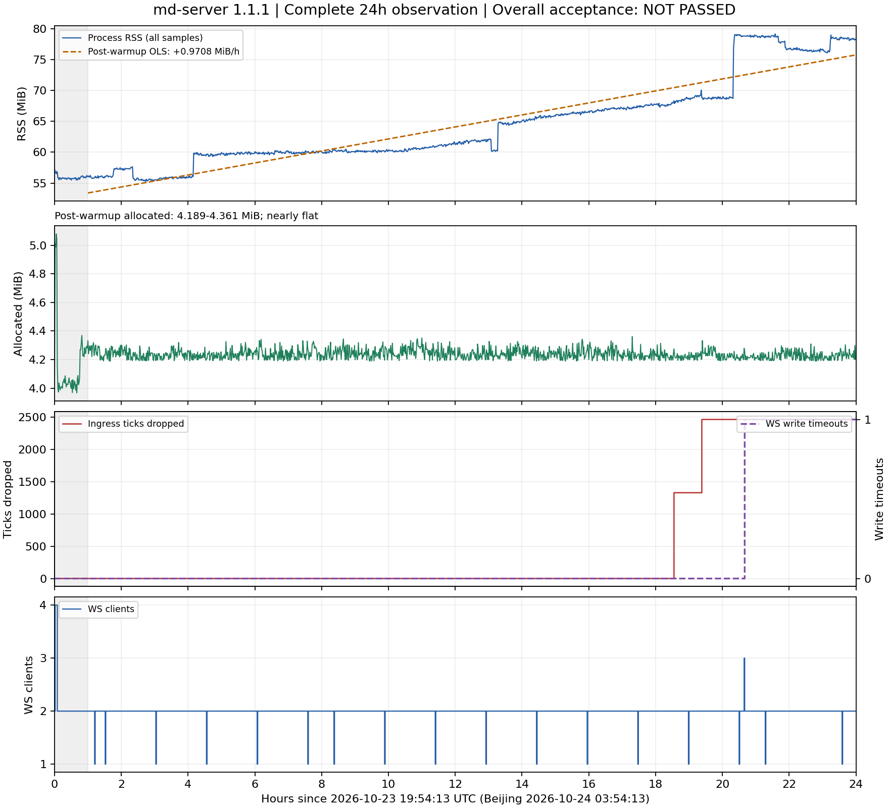

# 1.1.1 换版后完整24小时报告（北京时间2026-10-25）

**采集已完整结束，整体验收未通过。** SWAP_PLAN §6的RSS数值门槛与allocated持平要求满足；tick入口真实丢弃增长2460，不满足“掉tick不再增长”；1次写超时的客户端归因仍不充分，不能按已解释事件通过。报告交业务方转主审，未作任何准入豁免，不打标签、不合并PR，阶段3继续暂停。

## 一、做了什么

按已授权流程完成最终产物构建与复验、两小时新旧版同负载正对照、换版后即时补订阅、兼容比对、十分钟验收，以及本次实际完整24小时每分钟只读采集。换版UTC2026-10-23 19:53:15（北京时间10-24 03:53:15），中断7.1秒，即时恢复订阅12=12；旧版等待期未主动重启。

本次24h窗口为 **UTC10-23 19:54:13至10-24 19:54:19**，即**北京时间10-24 03:54:13至10-25 03:54:19**。原采样正常退出，未重启采样、清零计数、删除高点或重设基线。采集结束后只读复查在UTC20:10:02完成，单独保存于[final-state/](final-state/)，不算作原24h数据的延长。

- 唯一产物源码：`a06fe2095e8fc58bff1e038a594b25e7002aff1b`；vendored-tls + jemalloc，固定SOURCE_DATE_EPOCH、同路径两次从零构建字节一致。
- 二进制SHA-256：`3ffa127752ae8c13fc7646b5c75f8d3f1fa1c0b915b2bff596c1c93328c6c79d`。
- 现网镜像：`md-server:1.1.1`，ID `sha256:3250e021d152ad38b5b873325eae5f42364252881a1925b2a4ea6ca1b10cf010`。
- 现网容器：`5d6996ca9dc000c162c02ea3a4d5dca7baf29fd1a9cc98601c72a9552cecd812`；全窗process_start为1792785202，最终Docker RestartCount=0、healthy。
- 仍为512MiB、swap共1GiB、2CPU、unless-stopped；未改源码、缓冲区或生产资源。

## 二、怎么验证的（命令与原文）

可复跑本地分析，命令不连接生产、不改原始CSV：

```bash
python3 evidence/1.1.1/tools/analyze_post_swap_24h.py
python3 evidence/1.1.1/tools/plot_post_swap_24h.py
node scripts/compat/compare.mjs subs evidence/1.1.1/nas-198/post-swap-24h/subscriptions.before.json evidence/1.1.1/nas-198/post-swap-24h/final-state/subscriptions.json
```

分析脚本exit0仅表示分析成功；验收看`analysis.json → criteria.overall_pass`，本次为**false**。原文：[prod.csv](prod.csv)、[sampler-state.json](sampler-state.json)、[analysis.json](analysis.json)、[prod.events.log](prod.events.log)、[event-changes.csv](event-changes.csv)。

| SWAP_PLAN §6项目 | 实际结果 | 判定 |
|---|---|---|
| 实际连续覆盖≥24h | 86406秒；1441/1441有效点，所有字段无缺失；间隔59秒48次、60秒1338次、61秒54次，最大61秒 | 通过，无休眠/网络缺口被算入 |
| 进程无重启 | process_start始终1792785202，uptime无回退，最终RestartCount0；采样exit0、状态finished | 通过 |
| 预热1h后RSS斜率≤1MiB/h | 保留全部1381点、82806秒；OLS **+0.970764MiB/h** | 数值门槛通过 |
| allocated持平 | 4.189–4.361MiB，首4.332→末4.229MiB；OLS−0.000655MiB/h | 通过 |
| tick丢弃不再增长 | 0→1327→2460；最终2460，进程未清零 | **未通过** |
| 写超时为0或有可验证解释 | 0→1；发送超时机制已证实，具体测试及客户端停顿未证实 | **未通过：归因证据不足** |
| 订阅/连接及消费者 | 最终订阅12=12、缺失0/多出0、WS2、md-server/OMS healthy；存在17个孤立WS=1样本，具体客户端未定位 | 最终状态通过；全天消费者行为解释仍有保留，不能总判通过 |

RSS从窗口初始57.254MiB到末尾78.277MiB；预热后从56.035到78.277MiB，范围55.309–79.129MiB。斜率低于1的余量只有约0.0292MiB/h，**不能写成RSS完全不增长或已证明全天收敛**。显著单分钟台阶包括UTC00:04约+3.777MiB、09:11约+4.375MiB、16:14约+8.125MiB；均保留在回归与图中，根因未定位，不能随意归因到订阅浏览、写超时或上游突发。全天CPU累计增量1535.53秒，单核等效平均约1.777%，只代表整个窗口平均，不排除瞬时调度问题。



图的灰色区域为最初1小时预热；所有RSS台阶、丢弃计数、写超时及连接数变化均保留。[SVG导出版](observation-24h.svg)。

| 累计计数 | 首→末 | 增量 |
|---|---|---|
| ticks processed | 1165→4666327 | 4665162 |
| ticks dropped | 0→2460 | **2460** |
| klines processed / dropped | 246→523329 / 0→0 | 523083 / 0 |
| quotes processed / dropped | 2816→4911772 / 0→0 | 4908956 / 0 |
| WS write_timeout / lagged | 0→1 / 0→0 | **1** / 0 |
| connector reconnects：OKX tick / kline / quote | 0→5 / 0→2 / 0→3 | 5 / 2 / 3 |
| connector reconnects：Binance tick / quote | 0→1 / 0→1 | 1 / 1 |

全部上述计数无回退。入口丢tick、WS写超时与业务消费者内部去重计数是不同观测，不混为重复帧，也不把限频日志中可能累计的since-last-log逐行求和当作当次丢弃增量。

**掉tick独立说明。** 分钟采样UTC14:27:17发现0→1327，15:17:17发现1327→2460；第二次服务端/实时取证在15:16已出现。两家连接器WARN证实入口队列1000/1000、try_send真实丢弃。后续不再增加并不能抹去这项失败。事后61个约1秒点及CPU限流累计0仅解释事后状态，没有事发毫秒追踪或今天同窗口旧版正对照，不能证明上游微突发是唯一根因。旧版beaac94同样使用try_send/1000槽，历史D5仅证实机制既有，不是本次正对照或准入豁免。[独立五段式审计](anomalies/tick-drop-20261024T1427Z/REPORT.md)。

**写超时独立说明。** UTC16:34:08.768服务端记录一次sender.send等待超过10秒；16:33分钟点WS2→3、接收端12→24，REST订阅仍12；16:34点WS回2、接收端回12、写超时变1，之后至窗口结束保持1。固定“client is not reading”文案不能证实客户端事件循环停顿。业务方回复近期有其他测试、“应该是”，但不清楚具体测试；仅记可能关联，没有具体发起方/客户端日志，所以未判通过。不能套用换前17:51的说明，也不能用17:34的上游pong超时解释更早事件。[独立审计与业务方原话](anomalies/write-timeout-20261024T163408Z/REPORT.md)。

**订阅、连接与消费者说明。** REST订阅12有1439个点，13有2个点，均对应主审已确认的BNBUSDT 3m正常浏览订退两轮（UTC20:40/20:42 SUB+，20:41/20:43 SUB-，最后回12）。主审提供的UTC17:55:51–17:59:58浏览事件发生在换版前，不计入本窗。最终GET再次用compare.mjs验证12=12、缺失0/多出0。[最终订阅对比](final-state/compare-subs.log)。

WS=2共1419点；WS=4的4点为换后兼容抓取期间临时连接；WS=3的1点是上述写超时关联第三连接。另有**17个孤立WS=1分钟点**，每个下一点回2：UTC10-23的21:06、21:25、22:56；UTC10-24的00:27、01:58、03:29、04:16、05:47、07:18、08:49、10:20、11:51、13:22、14:53、16:24、17:11、19:29。不能把这些分钟样本等同17分钟精确断连时长，也不能仅凭周期相似认定原因。WARN级别日志缺少客户端身份，保留来源未定位的限制，没有观测到连续多个分钟点持续少连接。

五个上游connector绝大多数样本均连接，09:04 OKX kline和10:27 OKX tick各有一个分钟点连接总数降至4，下一点恢复5。其余重连原文分别保存在hourly日志中；17:34:48 Binance quote为pong timeout（90s）后按5秒重连。上游重连、业务WS重连和botd内部reconnects并非同一个计数。

1stbotv3主审docs/34已通过的是**换版后复核时段**：botd reconnects146→147仅+1，同样K线订退duplicates_dropped130522→130522增量0（旧版同测试+38），50条K线49条market_stream、1条重订间隙按既有契约由tick_agg补位并随后恢复；BNB两币对报价正常。此独立证据不扩展为整24h内部计数不变，本报告不凭服务端WS2替代全天消费者内部证明。OMS仅按计划只读检查；最终healthy，其当前StartedAt为UTC17:50:43，未操作OMS，也未将它推定为其它连接事件的原因。

## 三、没做什么与原因

没有用“采集结束”代替“全部达标”，也没有因2460后来不增长而重设基线。没有为凑PASS延长/重启采样，没有未经批准改1000槽缓冲、资源或行情代码。

掉tick出现后曾评估暂不回滚：旧版同入口机制且没有已证实改善，其他当时回滚触发条件未见；这不是准入豁免。新增单次写超时之后保存现场、复核额外连接已释放及业务基线恢复，业务方仅补充可能是其它测试；客户端归因不足和SWAP_PLAN §5的回滚评估未关闭，不能把未执行回滚写成该触发条件已经排除。当前仍维持1.1.1，报告明确交业务方/主审决定后续处置；没有主张已经获得例外批准。

停止备份曾被人工清理：UTC17:26按原名称及ID均404，原镜像仍在；业务方已明确确认“有人清理过”，具体时间、身份与规则未知。17:28用精确原1.1.0镜像重建同名**停止**回滚备份，新ID`9dbf93da4951fdf621a8d7642208c608d20b4f8710b124f454c9f40bfb653083`，created、restart=no；最终复读仍在。原两个更早备份未重建，原容器日志/身份不可恢复；只恢复当前所需1.1.0回滚准备，不能称所有备份都保留至今。旧镜像和latest最终仍在，latest未改。[重建原文](anomalies/write-timeout-20261024T163408Z/rollback-recreated.json)。

没有对生产做额外回滚演练或主动重启；没有写入153、OMS、策略系统、1stbotv3或latest；未打标签、未合并PR、未扩quote。2026-10-21历史重启原因仍未确认，不能写成已证实OOM。历史旁路约100个粗键命中未留逐条原文的限制仍保留。

## 四、兼容性声明（docs/24 §三）

1. 固定兼容回放5/5，换前最终镜像Gateway/Legacy的11个tick/kline主题240s逐字节通过；换后同窗口10主题通过。已完成项不重复运行或改写。
2. REST/gRPC源码未改；即时恢复及24h后最终订阅均12=12。正常浏览的临时+1按来源注释，不能掩盖非预期缺失。
3. Legacy永不含quote，换前9793条、换后6683条均quote0。
4. proto/RPC与字段号未改；原编译及回放验证通过。
5. 旧配置兼容；仅YAML info→warn，RUST_LOG=warn优先，SIGHUP/log_level属于本1.1.1。
6. md-tests11/11、workspace248/248、compare selftest25/25已实际通过；Docker E2E最终129/129，旧版正对照70/129。
7. metrics只增11指标族，无删除或TYPE/HELP变更；换后35个新增标签样本不能称35个新指标族。
8. 两小时真实新旧同负载对照7261秒、每侧122点有效；持续两消费者的预热后完整1h new RSS+0.0724、old+10.0034MiB/h，allocated持平。本窗为真实生产负载，不能拿旁路约22MiB替代初始生产约57MiB；也不能将该两小时旧版对照说成今天丢tick时段的同窗口对照。

旧quote兼容结论、Binance数量配对噪声不计、jemalloc必须、RUST_LOG优先、日志文案及版本归属等主审裁定均维持。本次新增真实入口丢弃不属于quote配对噪声，不在豁免范围。

## 五、需要对方做的事

本报告供业务方转主审复核：**采集完整，整体验收未通过**。请据掉tick实证、单次写超时的证据限制、短暂WS连接变化及当前健康状态决定后续处置；任何例外或后续修复都需明确决定，不能把本报告当作准入批准。停止备份清理规则应保留当前回滚资源。

当前回滚仍可按已授权计划执行；执行前须保存当时即时、非空订阅，切回后立即restore_subs并核对缺失0、健康和业务连接。回滚失败现场、备份和所有原始证据均保留，不只复用换版前旧订阅快照。

PR#2仅更新原评论6371055873；源码产物身份始终a06fe20。报告交付后删除本次观察自动化；不将§5未关闭事项悄悄变成新的无限期观察。不打标签、不合并PR，阶段3继续暂停，后续币对仍由业务方决定。
